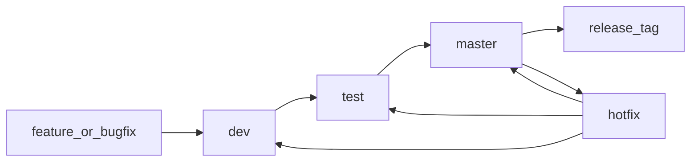

# Git 工作流规范

为 4 人前端团队制定的轻量 Git Flow，支持多人协作、测试环境验证、正式发布和紧急修复。

## 分支模型

当前保留 3 条长期分支：

- `dev`：日常开发集成分支，所有功能分支合并到这里。
- `test`：测试环境分支，只从 `dev` 合并，用于 QA/联调验证。
- `master`：正式环境分支，只从 `test` 合并，并在发布后打 tag。

短期分支按任务创建：

- `feat_[需求]_[负责人]_[YY/MM/DD]`：新功能，从 `dev` 拉出，完成后 MR 到 `dev`。
- `bugfix_[需求]_[负责人]_[YY/MM/DD]`：普通缺陷，从 `dev` 拉出，完成后 MR 到 `dev`。
- `hotfix_[需求]_[负责人]_[YY/MM/DD]`：线上紧急修复，从 `master` 拉出，修复后合并到 `master`，并同步回 `test`、`dev`。

## 日常开发流程

1. 开发者从最新 `dev` 拉功能分支：`feat_order-list_zhangsan_20260506`、`feat_search-filter_zhangsan_20260506` 等。
2. 每天开始开发前同步 `dev`，减少长期偏离。
3. 功能完成后提交 MR 到 `dev`，至少 1 人 Review。
4. MR 通过后合并到 `dev`，触发 CI：lint、type-check、build。
5. 固定发布窗口前，由负责人将 `dev` 合并到 `test`，部署测试环境。
6. 测试通过并确认本次发布范围后，将 `test` 合并到 `master`。
7. `master` 部署正式环境，并按版本号打 tag。



## 同文件协作规则

- 同一个页面或同一个大文件由一个人主改，其他人提前沟通区域，避免同时重构同一块。
- 大功能拆成小 MR，每个 MR 尽量控制在 300-500 行有效改动以内。
- 每天至少合并或 rebase 一次 `dev`，不要让功能分支超过 2-3 天不更新。
- 公共组件、接口封装、i18n 字段等共享区域改动，需要在群里提前说明。
- 出现冲突时，由最了解该模块的人主导解决，另一个人复核。

## 发布和冻结规则

固定周期发布时建议增加轻量冻结：

- `dev` 仍可继续合并下个版本功能。
- `test` 进入测试后，只接收当前版本修复，不再接收新功能。
- `master` 只接收来自 `test` 的发布合并或 `hotfix`。

## Hotfix 流程

线上紧急问题不要从 `dev` 修：

1. 从 `master` 创建 `hotfix_issue-name_zhangsan_20260506`。
2. 修复后 MR 到 `master`，发布正式环境并打 hotfix tag。
3. 同一修复必须同步回 `test`、`dev`，避免下次发布覆盖线上修复。

## 提交规范

使用 Conventional Commits，附带简体中文说明：

- `feat(product): 新增商品筛选交互`
- `fix(search): 修复搜索结果分页异常`
- `refactor(cart): 优化购物车状态计算逻辑`
- `chore(ci): 调整测试环境部署流程`

格式：`<type>(<scope>): <subject>`

常用 type：feat, fix, docs, style, refactor, perf, test, chore, ci

### 提交信息要求

- `scope` 使用本次改动所属的工作区包名；管理端改动统一使用 `elecbee-admin`。
- `subject` 使用简体中文，准确概括本次提交的核心目标，不加句号。
- 涉及多个改动点时，标题后空一行，再用 `-` 逐条列出简体中文说明；每条只描述一个完整改动，不加句号。
- 提交正文应覆盖依赖、配置、接口、交互、实体、字段和国际化等实际改动，不写未包含在本次提交中的内容。
- 提交前根据暂存区差异生成提交信息，确保标题和正文都能直接对应实际变更。
- Git 短哈希仅用于日志展示，不属于提交信息正文，不要手动写入提交标题。

示例：

```text
feat(elecbee-admin): 完善商品分类与系统实体交互

- 升级 disguise-ui 至 0.2.6，并同步工作区配置与锁文件
- 商品新增和编辑分类改为保留完整分类路径，修正分类字段类型
- 新增商品批量移动分类接口、移动弹窗提交逻辑、成功提示及列表刷新
- 新增岗位实体并注册到实体中心，用户岗位选择改用异步实体数据源
- 调整用户表单详情回填、角色岗位提交及头像字段配置
- 支持物流属性列表 HTML 内容展示
- 调整字典状态字段使用 sys_yes_no 字典
- 补充商品移动的中英文文案
```

提交后在 Git 日志中可能显示为：

```text
1147bc3 feat(elecbee-admin): 完善商品分类与系统实体交互
```

## MR 规范

MR 标题和提交风格一致，描述至少包含：

- 改了什么
- 影响范围
- 如何验证
- 是否涉及接口、i18n、样式响应式、环境变量

禁止直接提交到 `master`，必须通过 Pull Request 且至少 1 人 approve。

## 未来扩展：预发布环境

当需要客户验收或灰度验证时，可引入 `pre` 分支：

- `pre` 从 `test` 合并，用于上线前最终确认。
- `master` 改为只从 `pre` 合并。
- 发布链路扩展为 `dev -> test -> pre -> master`。
- `hotfix` 修复发布到 `master` 后，需要同步回 `pre`、`test`、`dev`。
